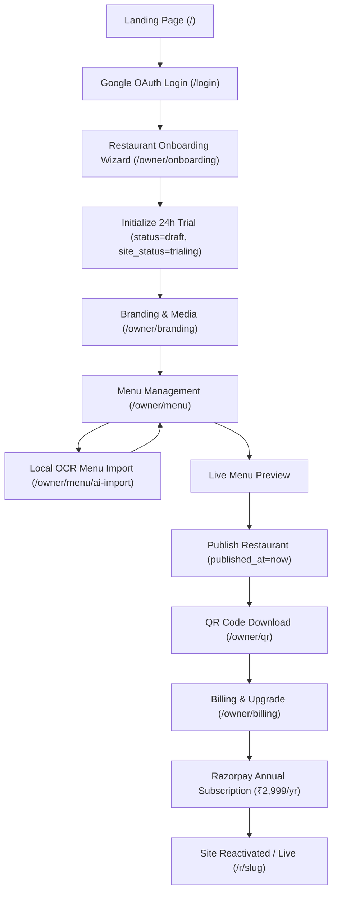

# ZaaykaTech SaaS — Comprehensive Owner & Public Menu Flow Specification

This document details the complete end-to-end user lifecycle, tenant isolation rules, storage architecture, subscription behavior, and staging deployment checklist for ZaaykaTech SaaS.

---

## 1. Owner Journey

1. **Landing Page (`/`)**:
   - Introduces ZaaykaTech digital QR menu platform for restaurants, cafes, and bakeries.
   - One-click CTA redirecting to Google Authentication.

2. **Authentication (`/login`, `/auth/callback`)**:
   - Secure Google OAuth sign-in managed via Supabase Auth.
   - Profile automatically provisioned in `profiles` table.

3. **Restaurant Creation & Onboarding (`/owner/onboarding`)**:
   - Multi-step wizard:
     - Basic details: Restaurant Name, Cuisine type, Phone, WhatsApp, City.
     - URL slug generation: Unique kebab-case slug (e.g. `the-royal-chai-pune`).
     - Branding: Logo upload, Hero image/video, Hero poster.
     - Theme selection: Palette (Emerald, Amber, Crimson, Indigo, Charcoal, Olive) and typography.
   - Invariant database state:
     - `status = 'draft'`
     - `site_status = 'trialing'`
     - `trial_ends_at = now() + 24 hours`
     - `published_at = NULL` (not published yet)

4. **Menu Management (`/owner/menu`)**:
   - Category CRUD with real-time drag-and-drop reordering.
   - Item CRUD: Name, description, dish image, veg/non-veg badge, spice level, tags (bestseller, chef's signature, seasonal).
   - Strict pricing exclusivity: Either single price OR variants (e.g., Regular ₹250 / Large ₹350), never both. All stored as non-negative integer paise.
   - Instant availability toggle (in-stock vs sold-out).

5. **Local OCR Menu Import (`/owner/menu/ai-import`)**:
   - Zero external API key dependencies.
   - Supports JPG/PNG/WebP (Sharp + Tesseract.js), selectable & scanned PDFs (`pdf-parse` + OCR fallback), CSV, and pasted plain text.
   - Review and correction UI before committing to the database.

6. **Publishing Rules**:
   - Can only publish if restaurant has at least 1 active category and 1 available item.
   - Publishing explicitly sets `published_at = now()`.
   - Never auto-published during onboarding.

7. **QR Code Generation (`/owner/qr`)**:
   - Vector SVG and high-resolution PNG downloads for physical table stands.
   - QR encodes direct link: `https://<domain>/r/<slug>`.

8. **Billing & Lifecycle Management (`/owner/billing`)**:
   - Live countdown of remaining trial hours.
   - Grace period alerts and expiry banners.
   - Razorpay upgrade modal triggering annual checkout (₹2,999/year).

---

## 2. Customer / Diner Journey

1. **Table QR Scan**:
   - Diner sits at table and scans the physical QR stand with their smartphone camera.
2. **Accessing `/r/[slug]`**:
   - Instant server-rendered loading with zero client-side redirects.
   - Responsive, mobile-first design with brand color theme and custom fonts.
3. **Menu Exploration**:
   - Sticky category jump-bar for fast navigation.
   - Veg / Non-Veg toggle filters.
   - Detailed dish popover showing descriptions, allergen tags, and variant options.
4. **Action Touchpoints**:
   - Direct call button (`tel:+91...`).
   - WhatsApp inquiry with pre-filled message.
   - Google Maps navigation directions.
   - Google Review link.
5. **Privacy First**:
   - Zero tracking cookies, zero popups, zero intrusive ads.

---

## 3. Trial & Grace Period Rules

The system implements a unified 9-state restaurant lifecycle:

| State | Public Menu Accessible? | Owner Access? | Condition |
| :--- | :--- | :--- | :--- |
| `draft` | ❌ No (404) | ✅ Full Access | Onboarding or unpublished |
| `preview` | ❌ No (404) | ✅ Full Access | Owner testing layout |
| `trialing` | ✅ Yes (Live) | ✅ Full Access | $t \le \text{trial\_ends} - 4\text{ hours}$ |
| `trial_ending` | ✅ Yes (Live) | ✅ Urgency Banner | $\text{trial\_ends} - 4\text{h} < t \le \text{trial\_ends}$ |
| `grace_period` | ✅ Yes (Live) | ✅ Warning Banner | $\text{trial\_ends} < t \le \text{trial\_ends} + 24\text{h}$ |
| `expired` | ❌ Offline (`ExpiredNotice`) | ✅ Can edit & upgrade | $t > \text{trial\_ends} + 24\text{h}$ |
| `active` | ✅ Yes (Live) | ✅ Full Access | Paid subscription active |
| `payment_overdue` | ❌ Offline (`ExpiredNotice`) | ✅ Can edit & renew | Subscription grace period |
| `suspended` | ❌ No (404) | ❌ Restricted | Administrative hold |

- **Trial Duration**: Exactly 24 hours.
- **Grace Period**: Exactly 24 hours after trial expiry.
- **Expiry Behavior**: The public URL displays an aesthetic, polite `ExpiredNotice` informing diners that the menu is temporarily offline.
- **Owner Continuity**: Owners are **never locked out** of their dashboard when their trial expires. They can freely log in, update menu items, upload dishes, and renew.

---

## 4. Subscription & Razorpay Billing Rules

1. **Pricing**:
   - Flat annual plan: **₹2,999 / 365 days** (299,900 paise).
   - No hidden platform fees or transaction commissions.
   - Zero automatic credit-card recurring charges.
2. **Order Creation (`POST /api/create-order`)**:
   - Minimum amount enforced: $\ge 100\text{ paise}$.
   - Secure server-side call using Basic Auth (`RAZORPAY_KEY_ID` + `RAZORPAY_KEY_SECRET`).
   - Secrets are strictly confined to the server environment.
3. **Payment Signature Verification (`POST /api/verify-payment`)**:
   - Algorithm:
     $$\text{HMAC-SHA256}(\text{order\_id} \parallel \text{"|"} \parallel \text{payment\_id}, \text{RAZORPAY\_KEY\_SECRET})$$
   - Constant-time comparison via `crypto.timingSafeEqual`.
   - On mismatch: Returns HTTP 400 and does NOT activate subscription.
4. **Webhook Handling (`POST /api/webhooks/razorpay`)**:
   - Verifies `x-razorpay-signature` against `RAZORPAY_WEBHOOK_SECRET`.
   - Supported events: `payment.captured`, `order.paid`, `payment.failed`.
   - Strict idempotency: Checks `payments.idempotency_key = paymentId`. Duplicate webhook deliveries return 200 without duplicate insertions.
5. **Subscription Extension Calculation**:
   - If renewed while currently active: $\text{new\_end\_date} = \text{existing\_end\_date} + 365\text{ days}$.
   - If renewed after expiry: $\text{new\_end\_date} = \text{now} + 365\text{ days}$.
   - Reactivates the public QR menu (`site_status = 'active'`) immediately without requiring new QR code printouts.

---

## 5. Media & Storage Rules

All media assets are stored exclusively in **Supabase Storage** under the `zaaykatech-media` bucket:

1. **Tenant-Scoped Folder Hierarchy**:
   - `restaurants/{restaurantId}/logo/`
   - `restaurants/{restaurantId}/hero/`
   - `restaurants/{restaurantId}/hero-poster/`
   - `restaurants/{restaurantId}/menu-items/{itemId}/`
   - `restaurants/{restaurantId}/qr/`
   - `restaurants/{restaurantId}/ai-imports/{uploadId}/`
2. **Storage RLS & Security**:
   - Enforced by database function `can_manage_restaurant_media(name)`:
     - Extracts `restaurant_id` from object name path (`split_part(name, '/', 2)`).
     - Verifies `auth.uid() = restaurants.owner_profile_id`.
   - Public read access enabled for diner CDN delivery.
   - Write/Update/Delete strictly restricted to the restaurant owner.
3. **Hero Video Rules**:
   - Maximum video size: **50 MB** (`video/mp4`, `video/webm`).
   - **Video files are NEVER stored in PostgreSQL**. Only CDN URLs are recorded.
   - Every hero video **strictly requires** an accompanying hero poster image (`image/jpeg`, `image/png`, `image/webp`, max 5 MB).
4. **General Limits**:
   - Logo / Item Images: 5 MB max.
   - OCR / Documents: 10 MB max (PDF / Image), 2 MB max (CSV).

---

## 6. Staging Deployment Checklist

Before deploying to staging (e.g. Netlify staging preview or custom staging branch):

- [x] **1. Environment Variables Configured**:
  - `NEXT_PUBLIC_SUPABASE_URL`: Supabase staging project URL.
  - `NEXT_PUBLIC_SUPABASE_ANON_KEY`: Supabase anon/publishable key.
  - `SUPABASE_SERVICE_ROLE_KEY`: Supabase service-role secret key.
  - `NEXT_PUBLIC_APP_URL`: Staging frontend URL (e.g. `https://staging.zaaykatech.com`).
  - `RAZORPAY_KEY_ID`: Razorpay test key ID (`rzp_test_...`).
  - `RAZORPAY_KEY_SECRET`: Razorpay test key secret.
  - `NEXT_PUBLIC_RAZORPAY_KEY_ID`: Same as test key ID for client checkout.
  - `RAZORPAY_WEBHOOK_SECRET`: Secret configured in Razorpay Webhooks dashboard.
- [x] **2. Database Migrations Applied**:
  - `20261113000001_core_schema.sql` (Tables, indexes, RLS, functions).
  - `20261113000002_supabase_storage.sql` (Bucket creation and storage RLS).
- [x] **3. Storage Bucket Active**:
  - Bucket `zaaykatech-media` exists with public read enabled and 50 MB file limit.
- [x] **4. Health Route Verified**:
  - Query `GET /api/health` returns status `200 OK` and `{ status: "healthy" }`.
- [x] **5. Typecheck & Build Passed**:
  - `npm run typecheck` passes with 0 errors.
  - `npm run build` generates all static and dynamic routes.
- [x] **6. Automated Verification Tests Passed**:
  - Phase 2 Verification (100%)
  - Phase 3 Verification (100%)
  - Phase 4 Verification (100%)
  - Phase 5 Verification (100%)
  - Local OCR Verification (100%)
  - Storage & RLS Verification (100%)
  - Razorpay Checkout & Webhook Verification (100%)
